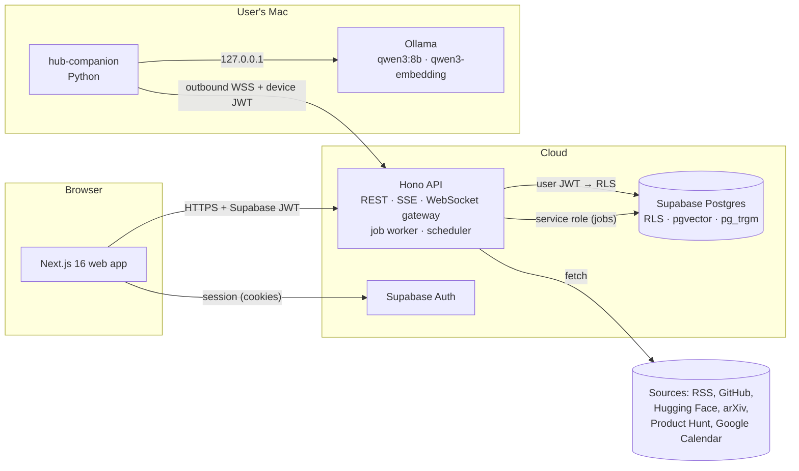

# Architecture

Personal AI Hub is a cloud-hosted application whose AI inference runs on the user's own Mac.
It is a pnpm/Turborepo monorepo with three deployable parts and one shared package.



## Components

| Part | Tech | Responsibility |
| --- | --- | --- |
| `apps/web` | Next.js 16.4 (App Router, Turbopack, Cache Components, React Compiler), React 19.3, Tailwind v4, shadcn/ui (Radix), TanStack Query | UI for all 15 pages. Static app shell; page content is client-rendered from the API. `proxy.ts` refreshes the Supabase session and redirects signed-out users. |
| `apps/api` | Node 24, Hono, supabase-js, zod 4, jose, ws, croner, undici | REST API, SSE streaming for the assistant, WebSocket gateway for companions, durable job worker and cron scheduler that run the agents. |
| `apps/companion` | Python 3.11+, httpx, websockets, pydantic | Runs next to Ollama; dials out to the API, authenticates as a device, validates and executes inference jobs. |
| `packages/shared` | TypeScript + zod | Domain constants, entity types and request schemas shared by API and web. |
| `supabase/migrations` | Postgres 17 SQL | Schema, Row Level Security, pgvector HNSW index, ranking/search/queue functions, reference data. |

## Request flow and authorization

1. The browser signs in with Supabase Auth (password or magic link). The session lives in cookies
   so `proxy.ts` can refresh it on navigation.
2. Every API call carries the Supabase access token. The API verifies it locally (JWKS for
   asymmetric signing keys, or the legacy HS256 secret), optionally enforces `ALLOWED_EMAILS`, and
   creates a **request-scoped Supabase client that acts as the user** — every query is filtered by
   Postgres Row Level Security.
3. Background agents run without a user session and use the service-role client; every such query
   is explicitly scoped by `user_id` (and private intelligence items are restricted to their owner).
4. Cross-table references use composite `(id, user_id)` foreign keys, so the database itself rejects
   rows that point at another user's goal, project, folder or conversation.

Secret-bearing tables (`device_credentials`, `device_pairing_codes`, `integration_credentials`) have
RLS enabled with no policies and no privileges for client roles.

## AI layer

```
business logic → AIService → ModelProvider ─┬─ CompanionProvider ── DeviceGateway ⇄ hub-companion ⇄ Ollama
                                            ├─ OllamaHttpProvider (same-host deployments)
                                            └─ OpenAICompatibleProvider (opt-in cloud fallback)
```

- **`ModelProvider`** (`apps/api/src/ai/types.ts`) is the only seam to inference: `chat`,
  `streamChat`, `embed`, `health`. Adding a runtime means implementing it — no business logic changes.
- **`AIService`** applies the user's settings (models, context length, temperature, reasoning),
  retries transient failures (device reconnects, timeouts), produces **structured JSON output**
  (zod → JSON Schema → Ollama `format`, validated with a repair pass), and handles embeddings
  (model-specific query/document prefixes, Matryoshka truncation to the 1024-dim column).
- **Provider resolution**: `auto` tries the companion, then direct Ollama, then the cloud provider
  only if the user allowed it. If nothing is available an `AIUnavailableError` (HTTP 503) is raised;
  background jobs are deferred instead of failing.
- **Chat and embedding models are separate** (`qwen3:8b` and `qwen3-embedding:0.6b` by default).

### Device gateway

Companions connect outbound to `wss://…/v1/devices/connect`; the upgrade is rejected with 401/403
before a socket exists if the device token or device is invalid. The gateway keeps connections in
memory, records health from heartbeats, pings every 30 s, closes connections whose 15-minute access
token expired, and dispatches jobs (`chat` streaming or not, `embed`, `health`) with timeouts and
cancellation. See [companion-protocol.md](./companion-protocol.md).

## Agents

Agents are plain modules with one responsibility each. They communicate through the database and
the durable job queue — there is no multi-agent framework.

| Agent | Module | Responsibilities | Triggers |
| --- | --- | --- | --- |
| Research | `agents/research` | Fetch configured sources, keep original URLs/timestamps/metrics, dedupe (URL hash + trigram title similarity), categorise, enrich thin items with article text | every 10 min (per-source intervals with failure backoff), manual refresh |
| AI News | `agents/ai-news` | Grounded per-feed summaries, why it matters, category, technologies (filtered to those in the source), importance; on-demand deep explanations | after ingestion, every 5 min |
| Developer Intelligence | `agents/developer` | Release monitoring for repositories on watchlists (framework repos are built-in sources) | every 4 h, when a repo is followed |
| Personal Productivity | `agents/productivity` | Reminder delivery, recurring task rollover, day planning, goal progress analysis, Google Calendar sync | every minute (reminders), on demand, every 30 min (calendar) |
| Knowledge | `agents/knowledge` | Import, chunk, embed and index documents; auto-category and tags; hybrid retrieval; cited Q&A | on save, every 10 min for pending docs, re-index on embedding model change |
| Briefing | `agents/briefing` | Build daily/weekly briefings from stored data; add an AI narrative grounded in that data | each user's local briefing time, on demand |
| Watchlist | `agents/watchlist` | Match new items to followed entities, record matches, send grouped alerts | after ingestion, every 15 min, 30-day backfill on follow |
| Assistant | `agents/assistant` | Tool-using chat loop; read-only tools run automatically, data-changing tools become proposals | per message |

### Durable job queue

`agent_jobs` + SQL functions give at-least-once background processing:

- `enqueue_agent_job` with a partial unique index on `dedupe_key` for active jobs (no duplicate work).
- `claim_agent_jobs` uses `FOR UPDATE SKIP LOCKED` so multiple workers never take the same job.
- Failures retry with exponential backoff (30 s → 1 h) up to `max_attempts`.
- Jobs that need local AI are **deferred without consuming attempts** while the Mac is offline
  (up to 24 h).
- `recover_stale_agent_jobs` re-queues jobs whose worker died (lock older than 15 min).

## Data model highlights

- `intelligence_items` holds public source content only; per-user state lives in
  `intelligence_item_states`, `bookmarks`, `watchlist_*`. Items from private sources carry
  `owner_user_id`.
- `intelligence_feed()` computes a personal relevance score in SQL (importance, interests, watchlist
  terms, freshness) as the caller, so RLS applies.
- `knowledge_chunks.embedding vector(1024)` with an HNSW cosine index; `match_knowledge()` fuses
  full-text and semantic ranks with Reciprocal Rank Fusion.
- Source dates are stored exactly as reported (`null` if absent — never guessed); AI-generated fields
  (`ai_summary`, `ai_why_it_matters`) are separate columns and always labelled in the UI.

## Prompt-injection defences

- Untrusted text (articles, saved documents, tool output) is wrapped in `<data>`/`<document>` blocks,
  delimiter look-alikes are stripped, and system prompts state that such content is data, never
  instructions.
- Consequential actions can't be triggered by content: assistant tools that change data only
  create proposals, executed after explicit user confirmation (atomically claimed, expiring, audited).
- Technologies extracted by AI are kept only if they literally appear in the source.

## Scaling notes

The MVP targets a single API instance: the device gateway's connection registry and the rate
limiter are in memory. To run several instances, move the rate limiter to Redis and route device
jobs through a shared bus (e.g. Redis pub/sub or Postgres `LISTEN/NOTIFY`) keyed by device id. The
job queue is already multi-worker safe.
